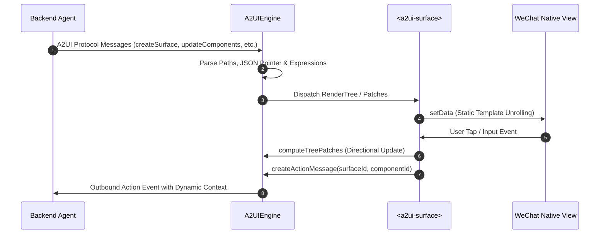

# a2ui-miniprogram

A2UI (Agent-to-User Interface) Native Renderer for WeChat MiniProgram.

遵循 [A2UI v1.0 规范](https://github.com/a2ui-project/a2ui)，专为微信小程序打造的原生渲染引擎与组件库。基于静态模板展开与差量更新架构，支持大模型生成式 UI 协议在小程序端的高性能渲染与双向交互。

<p align="center">
  <a href="https://www.npmjs.com/package/a2ui-miniprogram"></a>
  <a href="LICENSE"></a>
  <a href="https://nodejs.org/"></a>
  <a href="https://mp.weixin.qq.com/"></a>
  <a href="https://github.com/a2ui-project/a2ui"></a>
  <a href="https://oxc.rs/"></a>
  <a href="scripts/run-tests.js"></a>
  <a href="miniprogram/index.d.ts"></a>
</p>

---

## 特性

- **模板内联展开（Template Unrolling）**：预置 0~4 级静态展开模板，常用嵌套层级下以小程序原生标签直出，降低自定义组件实例数量与跨组件通信开销；超过 4 层时自动回退至 `<a2ui-surface-layer>` 跳板组件继续展开。
- **定向差量更新与防光标跳动**：内置 `computeTreePatches` 算法，在双向绑定输入过程中智能识别活跃输入节点，避免全量 `setData` 覆盖当前 `input` 产生的光标重置或输入法打断。
- **协议兼容**：完整实现 `createSurface`、`updateComponents`、`updateDataModel`、`deleteSurface` 以及端侧函数调用 `callRendererFunction`。
- **安全性设计**：
  - 正则表达式静态语法分析，拦截回溯风险高的复杂模式；
  - 数据模型路径操作过滤 `__proto__`、`constructor`、`prototype` 防范原型链污染；
  - Markdown 超链接仅放行 HTTP/HTTPS 协议，过滤伪协议与内嵌 HTML 注入。

---

## 架构概览



---

## 安装

```bash
npm install a2ui-miniprogram --save
```

在微信开发者工具菜单中点击：**工具 ➔ 构建 npm**。

---

## 快速开始

### 1. 页面配置引入组件

在页面的 `.json`（例如 `pages/index/index.json`）中声明组件：

```json
{
  "usingComponents": {
    "a2ui-surface": "a2ui-miniprogram/components/a2ui-surface/a2ui-surface"
  }
}
```

### 2. WXML 中挂载

```html
<view class="container">
  <a2ui-surface
    id="main-surface"
    surfaceId="user_form"
    bind:action="onAction"
    bind:inputChange="onInputChange"
  />
</view>
```

### 3. Page 逻辑编写

```javascript
import { A2UIEngine } from 'a2ui-miniprogram';

Page({
  onLoad() {
    this.engine = new A2UIEngine();

    // 监听用户点击 Action 等出站事件
    this.engine.onOutboundMessage((msg) => {
      console.log('Outbound message:', msg);
    });
  },

  onReady() {
    const surface = this.selectComponent('#main-surface');
    if (surface) {
      surface.setEngine(this.engine);
    }

    // 处理 A2UI 消息流
    this.engine.process([
      {
        version: 'v1.0',
        createSurface: {
          surfaceId: 'user_form',
          dataModel: { username: '' },
        },
      },
      {
        version: 'v1.0',
        updateComponents: {
          surfaceId: 'user_form',
          components: [
            {
              id: 'root',
              component: 'Card',
              children: ['col'],
            },
            {
              id: 'col',
              component: 'Column',
              children: ['title', 'input_name', 'submit_btn'],
            },
            {
              id: 'title',
              component: 'Text',
              text: '用户登录',
              variant: 'title',
            },
            {
              id: 'input_name',
              component: 'TextField',
              label: '用户名',
              value: { '@path': '/username' },
            },
            {
              id: 'submit_btn',
              component: 'Button',
              text: '提交',
              variant: 'primary',
              action: {
                event: {
                  name: 'submit_form',
                  context: { user: { '@path': '/username' } },
                },
              },
            },
          ],
        },
      },
    ]);
  },

  onAction(e) {
    const { action } = e.detail;
    console.log('User action triggered:', action);
  },

  onInputChange(e) {
    const { path, value } = e.detail;
    console.log(`Path ${path} changed to:`, value);
  },
});
```

---

## 支持组件

本项目已 **100% 完整对齐并支持 A2UI v1.0 官方 Basic Catalog 规范中的全部 18 种标准组件**：

| 组件 | 对应原生标签 / 实现 | 说明 |
| :--- | :--- | :--- |
| **Card** | `view.a2ui-card` | 卡片容器，支持内边距与子节点展开 |
| **Column** | `view.a2ui-column` | 垂直布局容器，支持 `align`, `justify` |
| **Row** | `view.a2ui-row` | 水平布局容器，支持 `weight` 比例自适应与对齐控制 |
| **List** | `scroll-view` | 滚动列表，支持垂直与水平滚动（`direction="horizontal"`） |
| **Text** | `text` / `rich-text` | 文本组件，支持标题等级、Markdown 内联/块级富文本解析 |
| **Image** | `image` | 图片展示，支持 `fit` 缩放模式与 webp 解码 |
| **Icon** | `text.a2ui-icon` | 图标符号 |
| **Video** | `video` | 视频播放器，支持视频流地址、封面海报与播放控件 |
| **AudioPlayer** | `view.a2ui-audio-card` | 音频播放器，支持音频流卡片与元信息展示 |
| **Button** | `button.a2ui-btn` | 操作按钮，支持 `primary`, `outlined`, `disabled` 与 Action 绑定 |
| **TextField**| `input.a2ui-input` | 输入框，支持遮罩密码、双向绑定与校验规则（checks） |
| **ChoicePicker**| 原生 `picker` / `chips` / `checkbox` | 单选/多选器，支持 `multipleSelection` 与 `mutuallyExclusive` |
| **DateTimeInput**| 原生 `picker` (date / time) | 日期/时间选择，自动转换 UTC ISO 与本地展示时间 |
| **CheckBox** | `checkbox-group` | 复选框，支持布尔值双向绑定 |
| **Slider** | `slider` | 滑块选择器，支持 `min`, `max`, `step` |
| **Divider** | `view.a2ui-divider` | 水平分割线 |
| **Tabs** | `scroll-view` + 标签栏 | 标签页容器，保持各标签页内容索引与局部状态隔离 |
| **Modal** | `view.a2ui-modal-mask` | 模态弹窗，支持触发器与遮罩弹层 |

此外，引擎支持通过 `engine.registerCustomComponent(name)` 注册宿主业务扩展组件；当遇到未知组件时，会自动激活 `<a2ui-custom-fallback>` 兜底容器，继续向下展开可识别的子节点。

---

## 业务自定义扩展组件与插槽 (Extension Architecture)

为了兼顾 0~4 级静态模板展开（Template Unrolling）的极速性能与业务自研组件的灵活挂载，`a2ui-miniprogram` 设计了**外围插槽（Macro Slots）+ 抽象节点（Micro Generics）**的双重扩展体系：

### 1. 宏观外围插槽 (Shell Slots)
在 `<a2ui-surface>` 顶层支持三个具名插槽：
- `slot="header"`：卡片顶部注入状态指示灯、Agent 思考中动效或导航条；
- `slot="empty"`：自定义骨架屏（Skeleton）、动效空态（未提供时保留默认 `emptyHint`）；
- `slot="footer"`：卡片底部注入快捷追问建议气泡条、AI 合规免责声明或吸底操作栏。

```html
<a2ui-surface surfaceId="my_surface" generic:a2ui-custom-node="custom-dispatcher">
  <!-- 顶部注入思考态 -->
  <view slot="header" class="agent-thinking-pill" wx:if="{{isThinking}}">
    <text>Agent 正在生成图表...</text>
  </view>
  <!-- 底部注入追问建议 -->
  <view slot="footer" class="prompt-chips">
    <text class="chip" bindtap="askNext">展开近30天走势 ↗</text>
  </view>
</a2ui-surface>
```

### 2. 微观节点扩展 (Component Generics)
通过微信小程序官方抽象节点挂载宿主业务组件（如 ECharts、腾讯地图、复杂营销卡片）：

#### 步骤 1：宿主编写分发器 `custom-dispatcher`
```html
<!-- custom-dispatcher.wxml -->
<my-chart wx:if="{{node.component === 'VegaChart'}}" node="{{node}}" surfaceId="{{surfaceId}}" />
<my-map wx:elif="{{node.component === 'MapMarker'}}" node="{{node}}" surfaceId="{{surfaceId}}" />
<my-accordion wx:elif="{{node.component === 'MyAccordion'}}" node="{{node}}" surfaceId="{{surfaceId}}" />
```

#### 步骤 2：业务组件继承 `a2uiCustomBehavior`
官方提供标准 Behavior，自动开启 `{ bubbles: true, composed: true }` 穿透 Shadow DOM，并集成 IME 拼音输入法合成保护：
```javascript
import { a2uiCustomBehavior } from 'a2ui-miniprogram';

Component({
  behaviors: [a2uiCustomBehavior],
  methods: {
    onTapPoint(data) {
      // 自动触发标准 A2UI Outbound Action
      this.dispatchAction({ selected: data });
    },
    onCustomInput(e) {
      // 自动享受 IME 拼音合成锁与防光标跳动
      this.handleSafeInput(e);
    }
  }
});
```

#### 步骤 3：容器型组件子树倒灌 (Subtree Re-injection)
若业务组件自身为折叠面板等容器并包含 `children`，在组件内部引入 `<a2ui-node-slot>` 即可将子节点重新倒灌回渲染流水线，零引擎实例化开销：
```html
<view class="accordion">
  <view class="accordion-head" bindtap="toggleOpen">{{node.title}}</view>
  <view class="accordion-body" wx:if="{{isOpen}}">
    <block wx:for="{{node.children}}" wx:key="id">
      <a2ui-node-slot node="{{item}}" surfaceId="{{surfaceId}}" uiState="{{uiState}}" scope="{{scope}}" />
    </block>
  </view>
</view>
```

> [!NOTE]
> **基础库兼容性**：抽象节点、默认兜底与虚拟化节点特性要求微信小程序基础库版本 **>= 2.14.0**（全网大盘用户覆盖率 **> 99.5%**）。低版本设备已内置 `:host` 块级降级样式与安全防御垫片，杜绝白屏与布局崩塌。

---

## API 参考

### `A2UIEngine`

```typescript
import { A2UIEngine } from 'a2ui-miniprogram';

const engine = new A2UIEngine();

// 处理单条或多条 A2UI 消息流
engine.process(messages);

// 获取指定 surfaceId 的渲染树
const tree = engine.getRenderTree('surface_id');

// 监听出站事件（Action / RPC 响应 / Error）
const unsubscribe = engine.onOutboundMessage((msg) => { ... });

// 注册客户端特权函数 (RPC)
engine.registerRendererFunction('getSystemInfo', (args) => {
  return wx.getSystemInfoSync();
});

// 计算两棵渲染树的差量补丁
const patches = engine.computeTreePatches(oldTree, newTree, 'localRenderTree');

// 释放引擎所有资源与监听器
engine.destroy();
```

### `<a2ui-surface>` 属性与方法

| 属性 / 方法 | 类型 | 默认值 | 说明 |
| :--- | :--- | :--- | :--- |
| `surfaceId` | `String` | `""` | 绑定的 Surface 唯一标识 |
| `conversationId` / `sessionId` | `String` | `""` | 会话 ID。变更时自动重置会话视图状态，保留外部注入引擎 |
| `renderTree` | `Object` | `null` | 直接传入预编译的渲染树进行单次渲染（无引擎模式） |
| `emptyHint` | `String` | `""` | 空态或过渡态占位文案 |
| `setEngine(engine)` | `Method` | - | 注入 `A2UIEngine` 实例并建立响应式监听 |
| `resetSession()` | `Method` | - | 重置当前会话视图状态，保留外部注入的引擎 |
| `clear(keepEngine)` | `Method` | - | 重置组件状态，传 `true` 时保留外部引擎 |

### `<a2ui-surface>` 事件

| 事件名 | 携带数据 (`e.detail`) | 说明 |
| :--- | :--- | :--- |
| `bind:action` | `{ surfaceId, componentId, action, eventMessage }` | 用户点击包含 `action` 的组件时触发 |
| `bind:inputChange` | `{ surfaceId, componentId, path, value }` | 表单输入触发双向绑定回写时触发 |
| `bind:rendered` | `{ surfaceId }` | 节点展开与 DOM 渲染就绪时触发 |
| `bind:error` | `{ version, error }` | 协议解析或运行时错误上报 |

---

## 主题定制 (Design Tokens)

`a2ui-miniprogram` 严格遵循**结构样式与主题视觉解耦**的设计理念：
- **核心组件标准样式**：仅包含标准弹性盒模型（Flexbox）、组件尺寸骨架与排版层级，默认提供高品质中性灰阶与现代品牌蓝回退。
- **业务换肤**：全面通过 CSS Variables 驱动，宿主小程序可在 `app.wxss` 或页面容器中声明变量直接定制。
- **画廊演示主题**：官方画廊的 Slate Lavender 紫色主题作为独立样式表提供在 `miniprogram/themes/theme-purple.wxss` 中，仅供 Demo 页面演示使用。

```css
/* 自定义主题示例 (在宿主页面的 wxss 中直接定义) */
page {
  --a2ui-primary-color: #07c160;          /* 品牌主色 (如微信绿) */
  --a2ui-primary-contrast: #ffffff;       /* 主色按钮文字前景 */
  --a2ui-surface-bg: #ffffff;             /* 卡片背景色 */
  --a2ui-card-radius: 20rpx;              /* 卡片圆角 */
  --a2ui-card-shadow: 0 4rpx 20rpx rgba(0, 0, 0, 0.06); /* 卡片阴影 */
  --a2ui-border-color: rgba(0, 0, 0, 0.08);/* 边框分割线颜色 */
}
```

---

## 测试

```bash
# 运行全部单测、安全防护与回归测试
npm test

# 运行无头自动化仿真测试
npm run test:sim

# 运行微信开发者工具自动化端到端测试
npm run test:e2e
```

---

## 版本发布

本项目使用 [@changesets/cli](https://github.com/changesets/changesets) 管理语义化版本：

```bash
# 创建变更集说明
npm run changeset

# 合并变更集并更新版本号与 CHANGELOG
npm run version-packages

# 发布至 npm
npm run release
```

---

## 贡献指南

欢迎提交 Issue 和 Pull Request，详细规范请参考 [CONTRIBUTING.md](CONTRIBUTING.md)。

---

## License

[MIT License](LICENSE)
