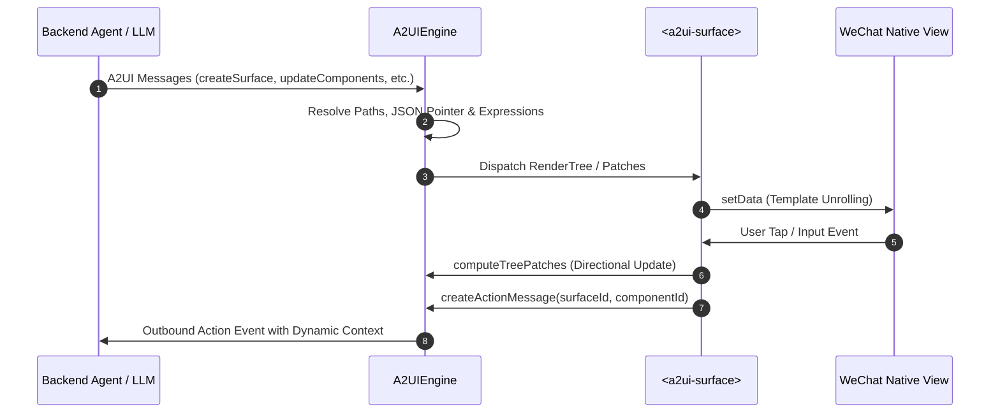

# a2ui-miniprogram

[WeChat Mini Program](https://developers.weixin.qq.com/miniprogram/dev/framework/) native renderer for the [A2UI (Agent-to-User Interface)](https://github.com/a2ui-project/a2ui) specification.

[English](README.md) | [简体中文](README.zh-CN.md)

<p align="center">
  <a href="https://www.npmjs.com/package/a2ui-miniprogram"></a>
  <a href="LICENSE"></a>
  <a href="https://nodejs.org/"></a>
  <a href="https://developers.weixin.qq.com/miniprogram/dev/framework/"></a>
  <a href="https://github.com/a2ui-project/a2ui"></a>
  <a href="scripts/run-tests.js"></a>
  <a href="miniprogram/index.d.ts"></a>
</p>

<p align="center">
  
</p>

---

## Features

- **A2UI v1.0 Spec Compliance**: Supports `createSurface`, `updateComponents`, `updateDataModel`, `deleteSurface`, and client RPC (`callRendererFunction`).
- **Template Unrolling**: Emits static WXML templates (levels 0–4) using native view tags, minimizing custom component instance overhead; falls back to `<a2ui-surface-layer>` beyond depth 4.
- **Directional Patching**: Calculates minimal differential updates (`computeTreePatches`) to prevent input cursor jumping during real-device typing.
- **Security**: Built-in polynomial/exponential ReDoS regex guards, prototype pollution sanitization (`__proto__`, `constructor`), and safe URL/markdown rendering.
- **Extensible**: Supports layout slots (`header`, `footer`, `empty`) and business custom components via WeChat `componentGenerics`.

---

## Architecture



---

## Installation

```bash
npm install a2ui-miniprogram --save
```

In WeChat Developer Tools, click **Tools ➔ Build npm**.

---

## Quick Start

### 1. Register Component

In your page JSON (e.g. `pages/index/index.json`):

```json
{
  "usingComponents": {
    "a2ui-surface": "a2ui-miniprogram/components/a2ui-surface/a2ui-surface"
  }
}
```

### 2. Add to WXML

```html
<view class="container">
  <a2ui-surface
    id="main-surface"
    surfaceId="user_form"
    bind:action="onAction"
    bind:inputChange="onInputChange"
  />
</view>
```

### 3. Initialize in Page

```javascript
import { A2UIEngine } from 'a2ui-miniprogram';

Page({
  onLoad() {
    this.engine = new A2UIEngine();

    this.engine.onOutboundMessage((msg) => {
      console.log('Outbound message to Agent:', msg);
    });
  },

  onReady() {
    const surface = this.selectComponent('#main-surface');
    if (surface) {
      surface.setEngine(this.engine);
    }

    // Process A2UI message payload
    this.engine.process([
      {
        version: 'v1.0',
        createSurface: {
          surfaceId: 'user_form',
          dataModel: { username: '' },
        },
      },
      {
        version: 'v1.0',
        updateComponents: {
          surfaceId: 'user_form',
          components: [
            { id: 'root', component: 'Card', children: ['col'] },
            { id: 'col', component: 'Column', children: ['title', 'input_name', 'submit_btn'] },
            { id: 'title', component: 'Text', text: 'Sign In', variant: 'title' },
            { id: 'input_name', component: 'TextField', label: 'Username', value: { '@path': '/username' } },
            {
              id: 'submit_btn',
              component: 'Button',
              text: 'Submit',
              variant: 'primary',
              action: {
                event: {
                  name: 'submit_form',
                  context: { user: { '@path': '/username' } },
                },
              },
            },
          ],
        },
      },
    ]);
  },

  onAction(e) {
    const { action } = e.detail;
    console.log('User action:', action);
  },

  onInputChange(e) {
    const { path, value } = e.detail;
    console.log(`Path ${path} changed to:`, value);
  },
});
```

---

## Supported Components

Covers all 18 standard components in the A2UI v1.0 Basic Catalog:

| Component | MiniProgram Native Implementation | Description |
| :--- | :--- | :--- |
| **Card** | `view.a2ui-card` | Container card with padding and elevation |
| **Column** | `view.a2ui-column` | Vertical flexbox (`align`, `justify`) |
| **Row** | `view.a2ui-row` | Horizontal flexbox with `weight` support |
| **List** | `scroll-view` | Vertical and horizontal scrollable lists |
| **Text** | `text` / `rich-text` | Typography and safe inline/block Markdown |
| **Image** | `image` | Responsive image with `fit` and WebP support |
| **Icon** | `text.a2ui-icon` | Semantic icon symbols |
| **Video** | `video` | Video player with poster and controls |
| **AudioPlayer** | `view.a2ui-audio-card` | Audio player card with track metadata |
| **Button** | `button.a2ui-btn` | Interactive button (`primary`, `outlined`, disabled) |
| **TextField** | `input.a2ui-input` | Text field with validation checks and two-way binding |
| **ChoicePicker** | `picker` / `chips` / `checkbox` | Single and multiple selection picker |
| **DateTimeInput**| `picker` (date / time) | Date and time picker with ISO UTC / local conversion |
| **CheckBox** | `checkbox-group` | Toggle checkbox with boolean data-binding |
| **Slider** | `slider` | Range slider with `min`, `max`, `step` |
| **Divider** | `view.a2ui-divider` | Visual separator line |
| **Tabs** | `scroll-view` + tab bar | Tabbed navigation container |
| **Modal** | `view.a2ui-modal-mask` | Overlay dialog with trigger control |

---

## Custom Components & Slots

### 1. Layout Slots

`<a2ui-surface>` provides three named slots for outer layout customization:

- `slot="header"`: Header area (e.g. status bar, agent thinking indicator).
- `slot="empty"`: Custom skeleton or empty state view.
- `slot="footer"`: Footer area (e.g. quick prompt chips, action bar).

```html
<a2ui-surface surfaceId="my_surface">
  <view slot="header" wx:if="{{isThinking}}">Generating response...</view>
  <view slot="footer">
    <button size="mini" bindtap="onQuickReply">Show 30-day trends</button>
  </view>
</a2ui-surface>
```

### 2. Custom Node Components

To render non-standard or business-specific components (e.g. ECharts, Map, custom widgets), declare a generic component dispatcher:

```html
<!-- In page WXML -->
<a2ui-surface
  surfaceId="dashboard"
  generic:a2ui-custom-node="custom-dispatcher"
/>
```

```html
<!-- custom-dispatcher.wxml -->
<my-chart wx:if="{{node.component === 'VegaChart'}}" node="{{node}}" surfaceId="{{surfaceId}}" />
<my-map wx:elif="{{node.component === 'MapView'}}" node="{{node}}" surfaceId="{{surfaceId}}" />
```

Use `a2uiCustomBehavior` to wire up standard action dispatching:

```javascript
import { a2uiCustomBehavior } from 'a2ui-miniprogram';

Component({
  behaviors: [a2uiCustomBehavior],
  methods: {
    handleSelect(item) {
      // Dispatches a standard A2UI action event up to the surface
      this.dispatchAction({ selectedId: item.id });
    },
  },
});
```

For container-type custom components with `children`, include `<a2ui-node-slot>` to render child A2UI nodes:

```html
<view class="my-accordion">
  <view class="accordion-title">{{node.title}}</view>
  <view class="accordion-content">
    <block wx:for="{{node.children}}" wx:key="id">
      <a2ui-node-slot node="{{item}}" surfaceId="{{surfaceId}}" uiState="{{uiState}}" scope="{{scope}}" />
    </block>
  </view>
</view>
```

> **Base Library Requirement**: MiniProgram base library `>= 2.14.0` (covering > 99.5% of WeChat users).

---

## Theming (Design Tokens)

Customization is driven by CSS Variables:

```css
/* In app.wxss or page.wxss */
page {
  --a2ui-primary-color: #07c160;          /* Brand primary */
  --a2ui-primary-contrast: #ffffff;       /* Button text on primary */
  --a2ui-surface-bg: #ffffff;             /* Surface / Card background */
  --a2ui-card-radius: 20rpx;              /* Card corner radius */
  --a2ui-card-shadow: 0 4rpx 20rpx rgba(0, 0, 0, 0.06);
  --a2ui-border-color: rgba(0, 0, 0, 0.08);
}
```

An optional Slate Lavender theme from the official A2UI catalog is provided at `miniprogram/themes/theme-purple.wxss`.

---

## API Reference

### `A2UIEngine`

```typescript
import { A2UIEngine } from 'a2ui-miniprogram';

const engine = new A2UIEngine();

// Process A2UI message array
engine.process(messages);

// Get render tree for a surface
const tree = engine.getRenderTree('surface_id');

// Subscribe to outbound actions, errors, and responses
const unsubscribe = engine.onOutboundMessage((msg) => { ... });

// Register custom client RPC function
engine.registerRendererFunction('getSystemInfo', (args) => {
  return wx.getSystemInfoSync();
});

// Calculate differential patches between two trees
const patches = engine.computeTreePatches(oldTree, newTree, 'localRenderTree');

// Cleanup
engine.destroy();
```

### `<a2ui-surface>` Properties & Methods

| Property / Method | Type | Default | Description |
| :--- | :--- | :--- | :--- |
| `surfaceId` | `String` | `""` | Target surface identifier |
| `conversationId` | `String` | `""` | Conversation ID (resets view state on change) |
| `renderTree` | `Object` | `null` | Directly pass a static render tree (standalone mode) |
| `emptyHint` | `String` | `""` | Default placeholder text when surface is empty |
| `setEngine(engine)` | `Method` | - | Bind an `A2UIEngine` instance |
| `resetSession()` | `Method` | - | Reset view state while keeping the engine bound |
| `clear(keepEngine)` | `Method` | - | Clear component state |

### `<a2ui-surface>` Events

| Event | `e.detail` | Description |
| :--- | :--- | :--- |
| `bind:action` | `{ surfaceId, componentId, action, eventMessage }` | Fired when a component action is triggered |
| `bind:inputChange` | `{ surfaceId, componentId, path, value }` | Fired on form input value change |
| `bind:rendered` | `{ surfaceId }` | Fired when surface finishes initial rendering |
| `bind:error` | `{ version, error }` | Fired on protocol parsing or runtime error |

---

## Testing

```bash
# Unit, security, and regression tests (23 suites)
npm test

# Headless simulation test
npm run test:sim

# Automator end-to-end test
npm run test:e2e
```

---

## Contributing

Please see [CONTRIBUTING.md](CONTRIBUTING.md) for details.

---

## License

[MIT License](LICENSE)
