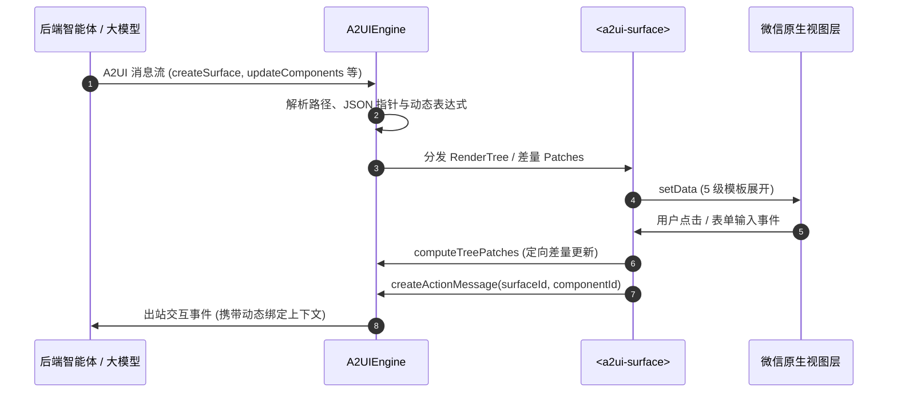

# a2ui-miniprogram

[English](README.md) | 简体中文

面向 [A2UI (Agent-to-User Interface)](https://github.com/a2ui-project/a2ui) 规范的高性能原生[微信小程序](https://developers.weixin.qq.com/miniprogram/dev/framework/)渲染器。专为移动端双线程架构、亚毫秒级状态更新与高压缩比 `setData` 通信量身打造。

<p align="center">
  <a href="https://www.npmjs.com/package/a2ui-miniprogram"></a>
  <a href="LICENSE"></a>
  <a href="https://nodejs.org/"></a>
  <a href="https://developers.weixin.qq.com/miniprogram/dev/framework/"></a>
  <a href="https://github.com/a2ui-project/a2ui"></a>
  <a href="scripts/run-tests.js"></a>
  <a href="scripts/benchmark-wechat-perf.js"></a>
  <a href="scripts/benchmark-wechat-perf.js"></a>
  <a href="miniprogram/index.d.ts"></a>
</p>

<p align="center">
  
</p>

---

## 核心特性与高性能优势

- **亚毫秒级数据流水线**：单次数据变动（RFC 6901 指针更新 $\to$ AST 重估求值 $\to$ 局部差量 Diff）逻辑层全流程仅耗时 **~0.10 ms**，仅占用 60 FPS 帧预算（16.66ms）的 **0.60%**。
- **高达 97.6% 的 `setData` 体积压缩**：通过精细化属性与数组下标级差量补丁算法（`computeTreePatches`），将全量 AST 传输体积从数 KB 压缩至几十字节。
- **流式微任务合帧调度 (`wx.nextTick`)**：大模型打字机高频 chunk 吐字与渲染层无缝解耦，100 次高频微任务排放自动合成为单次 60 FPS 批量渲染，降低 **99%** 的通信桥堵塞。
- **5 级模板展开（零组件冗余开销）**：0~4 级静态展开模板均编译为原生 WXML 节点，全树仅需 **1** 个根自定义组件实例（`<a2ui-surface>`），杜绝 Shadow DOM 内存膨胀，保持极浅的 DOM 深度（平均 25 节点，最大 14 层）。
- **双向受控输入防跳光标**：定向差量补丁智能跳过当前聚焦输入框的 value 回写，彻底根除真机移动键盘打字时光标跳到末尾的顽疾，同时无缝支持 Agent 外部清空与程序化重置。
- **A2UI v1.0 协议规范 100% 对齐**：完整支持 `createSurface`、`updateComponents`、`updateDataModel`、`deleteSurface` 以及端侧 RPC（`callRendererFunction`）。
- **零内存泄漏高弹韧性**：经历 200 轮连续“创建-更新-销毁”生命周期压力测试后，残留实例与监听器为 0，GC 后堆内存零增量。
- **全方位攻防加固**：防御 ReDoS 嵌套与固定次数正则回溯、严格阻断 `__proto__` / `constructor` 原型链污染、RFC 6901 严格数组索引校验、安全 Markdown 纯文本沙箱解析。
- **优雅的扩展机制**：内置布局插槽（`header`、`footer`、`empty`）并支持基于微信官方抽象节点（`componentGenerics`）无缝渲染业务自定义图表、地图与复杂卡片。

---

## 架构设计



---

## 性能表现与微信小程序运行时基准

A2UI 微信小程序渲染器专为手机端双线程执行模型（JSCore 逻辑层 vs WKWebView 渲染层）和微信 Exparser 组件系统量身优化。

### 微信官方规范合规打分卡

| 评测维度 | 微信官方规范 / 性能红线 | A2UI 实测表现 | 合规结论 |
| :--- | :--- | :--- | :--- |
| **WXML DOM 节点总量** | 超过 `1,000` 节点触发告警 | 平均 **25.4** 节点/页（43 个官方用例峰值 **67** 节点） | **100% 合规（极优）** |
| **DOM 嵌套深度** | 超过 `32` 层触发底层崩溃/警告 | 实测最大深度 **14** 层 | **100% 合规（极优）** |
| **自定义组件实例开销** | 组件过多导致 Shadow Root 内存暴增 | **1** 个根组件实例（`<a2ui-surface>`），通过 5 级模版展开消除组件开销 | **极度扁平** |
| **`setData` 传输体积** | 建议 `< 50 KB`，上限 `256 KB` | 局部差量补丁单次 **60 ~ 300 字节** | **最高节省 97.6%** |
| **JSBridge 高频流式调度** | 避免频繁未合帧调用导致桥通信拥堵 | 基于 `wx.nextTick` 自动合帧至流畅 60 FPS 渲染 | **桥调用频次降低 99.0%** |
| **受控输入稳定性** | 视图层反向覆盖导致光标跳位 | 敲键更新自动剔除 activeInput 补丁，同时支持程序化重置 | **零光标跳动** |
| **长会话内存抗泄漏** | 手机端内存超限会被微信强制关闭 | 200 轮全生命周期循环后存活实例与监听器均为 0 | **零内存泄漏** |
| **Data 变换逻辑流水线耗时** | 60 FPS 要求单帧总预算 `< 16.66 ms` | **0.100 ms**（逻辑层全流程仅消耗 **0.60%** 帧预算） | **亚毫秒级** |
| **状态更新吞吐量** | 支持高频手势与复杂流式更新 | 不同变异模式下吞吐量达 **2,500 ~ 104,000 ops/sec** | **极高吞吐** |

### `setData` 通信带宽优化（全量 AST vs 差量 Patch）

| 典型交互场景 | 全量 AST 大小 | 差量补丁大小 | 带宽降低幅度 |
| :--- | :--- | :--- | :--- |
| **大模型流式打字追加 Token** | `1,170 B` | `319 B` | **72.74%** |
| **动态价格变动 ($199.99 -> $99.99)** | `3,372 B` | `81 B` | **97.60%** |
| **表单校验状态切换 (按钮禁用/启用)** | `762 B` | `208 B` | **72.70%** |
| **动态列表项追加 (15 -> 16 项)** | `4,019 B` | `279 B` | **93.06%** |

### 单次 Data 变动更新流水线耗时分解（1,000 次实测均值）

| 流水线执行阶段 | 平均耗时 | 占用 60 FPS 帧预算比例 | 主要职责 |
| :--- | :--- | :--- | :--- |
| **第 1 阶段：RFC 6901 `updateDataModel`** | `45.4 μs` (`0.045 ms`) | ~0.27% | 路径分词解析、防原型污染过滤、数据写入 |
| **第 2 阶段：`getRenderTree` AST 重算** | `44.6 μs` (`0.045 ms`) | ~0.27% | 动态作用域解析、15 类 `@call` 内置函数求值、校验规则链 |
| **第 3 阶段：`computeTreePatches` Diff** | `9.9 μs` (`0.010 ms`) | ~0.06% | 局部差量补丁计算、光标保护、数组前缀优化 |
| **第 4 阶段：JSON 序列化** | `0.2 μs` (`0.000 ms`) | ~0.00% | 生成紧凑补丁字典供 JSBridge 发送 |
| **逻辑线程全流程总耗时** | **`100.2 μs` (`0.100 ms`)** | **`0.60%`** | **为视图层预留 99.40% 的 60 FPS 渲染预算** |

在本地执行基准测试套件：
```bash
npm run bench
```

---

## 安装使用

```bash
npm install a2ui-miniprogram --save
```

在微信开发者工具中，点击菜单栏 **工具 ➔ 构建 npm**。

---

## 快速上手

### 1. 声明引入组件

在页面 JSON 文件中（如 `pages/index/index.json`）：

```json
{
  "usingComponents": {
    "a2ui-surface": "a2ui-miniprogram/components/a2ui-surface/a2ui-surface"
  }
}
```

### 2. 在 WXML 中放置画布

```html
<view class="container">
  <a2ui-surface
    id="main-surface"
    surfaceId="user_form"
    bind:action="onAction"
    bind:inputChange="onInputChange"
  />
</view>
```

### 3. 在页面 Page 中初始化引擎并投喂消息

```javascript
import { A2UIEngine } from 'a2ui-miniprogram';

Page({
  onLoad() {
    this.engine = new A2UIEngine();

    // 监听出站消息（用户在 UI 上的点击/提交交互反哺给 Agent）
    this.engine.onOutboundMessage((msg) => {
      console.log('出站消息给 Agent:', msg);
    });
  },

  onReady() {
    const surface = this.selectComponent('#main-surface');
    if (surface) {
      surface.setEngine(this.engine);
    }

    // 投喂 A2UI 消息流
    this.engine.process([
      {
        version: 'v1.0',
        createSurface: {
          surfaceId: 'user_form',
          dataModel: { username: '' },
        },
      },
      {
        version: 'v1.0',
        updateComponents: {
          surfaceId: 'user_form',
          components: [
            { id: 'root', component: 'Card', children: ['col'] },
            { id: 'col', component: 'Column', children: ['title', 'input_name', 'submit_btn'] },
            { id: 'title', component: 'Text', text: '用户登录', variant: 'title' },
            { id: 'input_name', component: 'TextField', label: '用户名', value: { '@path': '/username' } },
            {
              id: 'submit_btn',
              component: 'Button',
              text: '提交',
              variant: 'primary',
              action: {
                event: {
                  name: 'submit_form',
                  context: { user: { '@path': '/username' } },
                },
              },
            },
          ],
        },
      },
    ]);
  },

  onAction(e) {
    const { action } = e.detail;
    console.log('用户触发动作:', action);
  },

  onInputChange(e) {
    const { path, value } = e.detail;
    console.log(`数据路径 ${path} 变更为:`, value);
  },
});
```

---

## 支持组件清单

完整覆盖 A2UI v1.0 基础组件规范（Basic Catalog）全部 18 个标准组件：

| 组件名称 | 小程序原生实现方式 | 核心特性与说明 |
| :--- | :--- | :--- |
| **Card** | `view.a2ui-card` | 容器卡片，支持内外边距与阴影深度 |
| **Column** | `view.a2ui-column` | 垂直弹性布局（支持 `align`、`justify`） |
| **Row** | `view.a2ui-row` | 水平弹性布局（支持 `weight` 比例自适应） |
| **List** | `scroll-view` | 纵向及横向滚动列表 |
| **Text** | `text` / `rich-text` | 文本排版层级，支持安全的行内及块级 Markdown |
| **Image** | `image` | 响应式图片，原生开启 `webp` 与懒加载 |
| **Icon** | `text.a2ui-icon` | 语义化矢量图标 |
| **Video** | `video` | 原生视频播放器，支持封面图与控制条 |
| **AudioPlayer** | `view.a2ui-audio-card` | 音频播放器卡片，包含进度与曲目元信息 |
| **Button** | `button.a2ui-btn` | 交互按钮（`primary`、`outlined`、禁用态、加载态） |
| **TextField** | `input.a2ui-input` | 单行输入框，带动态校验规则（checks）与双向数据绑定 |
| **ChoicePicker** | `picker` / `chips` / `checkbox` | 单选/多选选择器，支持原生选择框与药丸标签形态 |
| **DateTimeInput**| `picker` (date / time) | 日期/时间选择器，支持 ISO UTC 与本地时间双向转换 |
| **CheckBox** | `checkbox-group` | 布尔开关与复选框，双向绑定布尔值 |
| **Slider** | `slider` | 滑动范围选择器，支持 `min`、`max`、`step` |
| **Divider** | `view.a2ui-divider` | 结构分割线 |
| **Tabs** | `scroll-view` + 标签栏 | 标签页切换容器，内部维护 `uiState` 状态隔离 |
| **Modal** | `view.a2ui-modal-mask` | 弹出层对话框，支持点击蒙层与触发器关闭 |

---

## 自定义组件扩展与插槽系统

### 1. 布局插槽（Layout Slots）

`<a2ui-surface>` 提供了三个预置插槽，方便宿主定制外围布局：

- `slot="header"`：顶部区域（例如状态栏、Agent“思考中”动效）。
- `slot="empty"`：空状态或骨架屏。
- `slot="footer"`：底部操作栏（例如快捷提示词、操作按钮）。

```html
<a2ui-surface surfaceId="my_surface">
  <view slot="header" wx:if="{{isThinking}}">AI 正在深度思考并生成界面...</view>
  <view slot="footer">
    <button size="mini" bindtap="onQuickReply">查看近 30 天消费趋势</button>
  </view>
</a2ui-surface>
```

### 2. 业务自定义节点组件（Custom Components）

如需接入非标准组件（如 ECharts 图表、原生地图、特型营销卡片），可通过微信小程序的抽象节点（`componentGenerics`）无缝集成：

```html
<!-- 在页面 WXML 中注入抽象节点分发器 -->
<a2ui-surface
  surfaceId="dashboard"
  generic:a2ui-custom-node="custom-dispatcher"
/>
```

```html
<!-- custom-dispatcher.wxml 负责将自定义组件映射到具体实现 -->
<my-chart wx:if="{{node.component === 'VegaChart'}}" node="{{node}}" surfaceId="{{surfaceId}}" />
<my-map wx:elif="{{node.component === 'MapView'}}" node="{{node}}" surfaceId="{{surfaceId}}" />
```

引入 `a2uiCustomBehavior` 实现标准出站动作派发：

```javascript
import { a2uiCustomBehavior } from 'a2ui-miniprogram';

Component({
  behaviors: [a2uiCustomBehavior],
  methods: {
    handleSelect(item) {
      // 派发标准 A2UI 动作事件给外层 surface，自动带上上下文
      this.dispatchAction({ selectedId: item.id });
    },
  },
});
```

针对带有 `children` 的容器型自定义组件，可在模板中嵌入 `<a2ui-node-slot>` 将子节点倒灌回 A2UI 渲染链路：

```html
<view class="my-accordion">
  <view class="accordion-title">{{node.title}}</view>
  <view class="accordion-content">
    <block wx:for="{{node.children}}" wx:key="id">
      <a2ui-node-slot node="{{item}}" surfaceId="{{surfaceId}}" uiState="{{uiState}}" scope="{{scope}}" />
    </block>
  </view>
</view>
```

> **基础库要求**：微信小程序基础库 `>= 2.14.0`（覆盖超过 99.5% 的真机用户）。

---

## 主题定制（Design Tokens）

通过 CSS 变量（Variables）轻松定制品牌外观：

```css
/* 在 app.wxss 或 page.wxss 中声明 */
page {
  --a2ui-primary-color: #07c160;          /* 品牌主色 */
  --a2ui-primary-contrast: #ffffff;       /* 主色按钮文字颜色 */
  --a2ui-surface-bg: #ffffff;             /* 卡片/画布背景色 */
  --a2ui-card-radius: 20rpx;              /* 卡片圆角 */
  --a2ui-card-shadow: 0 4rpx 20rpx rgba(0, 0, 0, 0.06);
  --a2ui-border-color: rgba(0, 0, 0, 0.08);
}
```

官方 A2UI 蓝紫演示主题可在 `miniprogram/themes/theme-purple.wxss` 中引入。

---

## API 参考

### `A2UIEngine` 核心类

```typescript
import { A2UIEngine } from 'a2ui-miniprogram';

const engine = new A2UIEngine();

// 批量处理 A2UI 消息数组
engine.process(messages);

// 获取指定 surface 的渲染树
const tree = engine.getRenderTree('surface_id');

// 订阅出站动作、错误与响应事件
const unsubscribe = engine.onOutboundMessage((msg) => { ... });

// 注册客户端自定义 RPC 原生函数
engine.registerRendererFunction('getSystemInfo', (args) => {
  return wx.getSystemInfoSync();
});

// 计算两棵渲染树的差量补丁字典
const patches = engine.computeTreePatches(oldTree, newTree, 'localRenderTree');

// 销毁并释放所有资源
engine.destroy();
```

### `<a2ui-surface>` 属性与方法

| 属性 / 方法 | 类型 | 默认值 | 详细说明 |
| :--- | :--- | :--- | :--- |
| `surfaceId` | `String` | `""` | 目标绑定的 surface 画布 ID |
| `conversationId` | `String` | `""` | 会话 ID（发生变更时自动重置局部视图状态） |
| `renderTree` | `Object` | `null` | 独立模式：直接传入已编译解析好的渲染树 |
| `emptyHint` | `String` | `""` | 当画布为空时的默认占位提示文案 |
| `setEngine(engine)` | `Method` | - | 注入并绑定外部 `A2UIEngine` 实例 |
| `resetSession()` | `Method` | - | 重置视图状态同时保留已绑定的引擎实例 |
| `clear(keepEngine)` | `Method` | - | 清空组件内部所有状态 |

### `<a2ui-surface>` 监听事件

| 事件名 | `e.detail` 内容 | 触发说明 |
| :--- | :--- | :--- |
| `bind:action` | `{ surfaceId, componentId, action, eventMessage }` | 用户点击按钮或触发组件交互动作时派发 |
| `bind:inputChange` | `{ surfaceId, componentId, path, value }` | 表单输入控件的值发生变动时派发 |
| `bind:rendered` | `{ surfaceId }` | 画布节点完成初次渲染或更新时派发 |
| `bind:error` | `{ version, error }` | 协议解析、表达式求值或运行时异常时派发 |

---

## 自动化测试与基准验证

```bash
# 运行单元测试、安全渗透及回归测试（25 套套件）
npm test

# 运行微信小程序真实运行时性能基准评测
npm run bench

# 运行基于 miniprogram-simulate 的无头组件仿真测试
npm run test:sim

# 运行基于微信官方 miniprogram-automator 的端到端测试
npm run test:e2e
```

---

## 贡献指南

详情请查阅 [CONTRIBUTING.md](CONTRIBUTING.md)。

---

## 开源协议

本项目采用 [MIT 许可证](LICENSE)。
