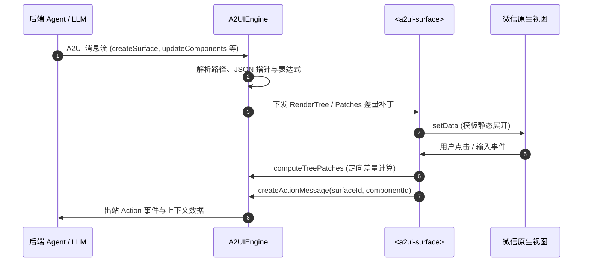

# a2ui-miniprogram

[A2UI (Agent-to-User Interface)](https://github.com/a2ui-project/a2ui) 规范的[微信小程序（WeChat Mini Program）](https://developers.weixin.qq.com/miniprogram/dev/framework/)原生渲染器。

[English](./) | 简体中文

<p align="center">
  <a href="https://www.npmjs.com/package/a2ui-miniprogram"></a>
  <a href="LICENSE"></a>
  <a href="https://nodejs.org/"></a>
  <a href="https://developers.weixin.qq.com/miniprogram/dev/framework/"></a>
  <a href="https://github.com/a2ui-project/a2ui"></a>
  <a href="scripts/run-tests.js"></a>
  <a href="miniprogram/index.d.ts"></a>
</p>

<p align="center">
  
</p>

---

## 特性

- **A2UI v1.0 协议对齐**：完整支持 `createSurface`、`updateComponents`、`updateDataModel`、`deleteSurface` 及端侧函数调用 `callRendererFunction`。
- **模板静态展开（Template Unrolling）**：0~4 级预置展开模板，常用层级以原生 view 标签直出，降低组件实例开销；超过 4 层回退至 `<a2ui-surface-layer>` 跳板组件继续展开。
- **定向差量更新**：内置 `computeTreePatches` 算法，在双向绑定输入时差量定向更新，避免因 `setData` 引起真机输入框光标跳动。
- **安全防护**：内置 ReDoS 正则回溯检测、原型链污染过滤（`__proto__`、`constructor`）与安全链接/富文本解析。
- **灵活扩展**：支持布局插槽（`header`、`footer`、`empty`）与基于微信抽象节点（`componentGenerics`）的自定义组件挂载。

---

## 架构



---

## 安装

```bash
npm install a2ui-miniprogram --save
```

在微信开发者工具菜单中点击：**工具 ➔ 构建 npm**。

---

## 快速上手

### 1. 引入组件

在页面的 `.json`（例如 `pages/index/index.json`）中声明：

```json
{
  "usingComponents": {
    "a2ui-surface": "a2ui-miniprogram/components/a2ui-surface/a2ui-surface"
  }
}
```

### 2. 页面 WXML 挂载

```html
<view class="container">
  <a2ui-surface
    id="main-surface"
    surfaceId="user_form"
    bind:action="onAction"
    bind:inputChange="onInputChange"
  />
</view>
```

### 3. 页面逻辑

```javascript
import { A2UIEngine } from 'a2ui-miniprogram';

Page({
  onLoad() {
    this.engine = new A2UIEngine();

    // 监听出站事件 (回传给 Agent)
    this.engine.onOutboundMessage((msg) => {
      console.log('Outbound message:', msg);
    });
  },

  onReady() {
    const surface = this.selectComponent('#main-surface');
    if (surface) {
      surface.setEngine(this.engine);
    }

    // 处理 A2UI 协议消息
    this.engine.process([
      {
        version: 'v1.0',
        createSurface: {
          surfaceId: 'user_form',
          dataModel: { username: '' },
        },
      },
      {
        version: 'v1.0',
        updateComponents: {
          surfaceId: 'user_form',
          components: [
            { id: 'root', component: 'Card', children: ['col'] },
            { id: 'col', component: 'Column', children: ['title', 'input_name', 'submit_btn'] },
            { id: 'title', component: 'Text', text: '用户登录', variant: 'title' },
            { id: 'input_name', component: 'TextField', label: '用户名', value: { '@path': '/username' } },
            {
              id: 'submit_btn',
              component: 'Button',
              text: '提交',
              variant: 'primary',
              action: {
                event: {
                  name: 'submit_form',
                  context: { user: { '@path': '/username' } },
                },
              },
            },
          ],
        },
      },
    ]);
  },

  onAction(e) {
    const { action } = e.detail;
    console.log('Action triggered:', action);
  },

  onInputChange(e) {
    const { path, value } = e.detail;
    console.log(`Path ${path} changed to:`, value);
  },
});
```

---

## 支持组件

完整支持 A2UI v1.0 官方 Basic Catalog 规范中的全部 18 种标准组件：

| 组件 | 对应原生标签 / 实现 | 说明 |
| :--- | :--- | :--- |
| **Card** | `view.a2ui-card` | 卡片容器，支持内边距与阴影 |
| **Column** | `view.a2ui-column` | 垂直布局容器，支持 `align`, `justify` |
| **Row** | `view.a2ui-row` | 水平布局容器，支持 `weight` 比例自适应 |
| **List** | `scroll-view` | 滚动列表，支持水平与垂直方向 |
| **Text** | `text` / `rich-text` | 文本排版，支持 Markdown 渲染与安全过滤 |
| **Image** | `image` | 图片展示，支持 `fit` 缩放与 WebP |
| **Icon** | `text.a2ui-icon` | 语义图标 |
| **Video** | `video` | 视频播放器，支持封面与控件配置 |
| **AudioPlayer** | `view.a2ui-audio-card` | 音频播放卡片与元信息展示 |
| **Button** | `button.a2ui-btn` | 操作按钮（`primary`, `outlined`, disabled） |
| **TextField** | `input.a2ui-input` | 文本输入框，支持密码遮罩、校验与双向绑定 |
| **ChoicePicker** | `picker` / `chips` / `checkbox` | 单选与多选器 |
| **DateTimeInput**| `picker` (date / time) | 日期时间选择器，自动转换 UTC ISO 与本地时间 |
| **CheckBox** | `checkbox-group` | 复选框，支持布尔值绑定 |
| **Slider** | `slider` | 滑动条，支持 `min`, `max`, `step` |
| **Divider** | `view.a2ui-divider` | 分割线 |
| **Tabs** | `scroll-view` + 标签栏 | 标签页导航容器 |
| **Modal** | `view.a2ui-modal-mask` | 模态弹窗遮罩层 |

---

## 自定义组件与插槽

### 1. 布局插槽

`<a2ui-surface>` 提供三个具名插槽用于自定义卡片外部结构：

- `slot="header"`：卡片头部（如状态指示器、思考态动画）。
- `slot="empty"`：自定义空态或骨架屏（未传入时使用默认占位）。
- `slot="footer"`：卡片底部（如快捷追问气泡、操作栏）。

```html
<a2ui-surface surfaceId="my_surface">
  <view slot="header" wx:if="{{isThinking}}">思考中...</view>
  <view slot="footer">
    <button size="mini" bindtap="onQuickReply">近30天走势 ↗</button>
  </view>
</a2ui-surface>
```

### 2. 挂载自定义组件

遇到未内置的业务组件（如 ECharts 图表、地图等），可通过小程序抽象节点（Component Generics）接入：

```html
<!-- 页面 WXML -->
<a2ui-surface
  surfaceId="dashboard"
  generic:a2ui-custom-node="custom-dispatcher"
/>
```

```html
<!-- custom-dispatcher.wxml 负责分发组件 -->
<my-chart wx:if="{{node.component === 'VegaChart'}}" node="{{node}}" surfaceId="{{surfaceId}}" />
<my-map wx:elif="{{node.component === 'MapView'}}" node="{{node}}" surfaceId="{{surfaceId}}" />
```

业务组件中混入 `a2uiCustomBehavior`，即可调用标准事件通信：

```javascript
import { a2uiCustomBehavior } from 'a2ui-miniprogram';

Component({
  behaviors: [a2uiCustomBehavior],
  methods: {
    handleSelect(item) {
      // 触发标准 A2UI Action 并冒泡到 surface
      this.dispatchAction({ selectedId: item.id });
    },
  },
});
```

若自定义组件自身包含 `children`（如折叠面板），可在组件内引入 `<a2ui-node-slot>` 递归渲染子节点：

```html
<view class="my-accordion">
  <view class="accordion-title">{{node.title}}</view>
  <view class="accordion-content">
    <block wx:for="{{node.children}}" wx:key="id">
      <a2ui-node-slot node="{{item}}" surfaceId="{{surfaceId}}" uiState="{{uiState}}" scope="{{scope}}" />
    </block>
  </view>
</view>
```

> **基础库兼容要求**：微信小程序基础库版本 `>= 2.14.0`（覆盖率 > 99.5%）。

---

## 主题定制 (CSS Variables)

组件库遵循结构与视觉解耦原则，可通过 CSS 变量进行定制：

```css
/* 在 app.wxss 或页面 wxss 中定义 */
page {
  --a2ui-primary-color: #07c160;          /* 品牌主色 */
  --a2ui-primary-contrast: #ffffff;       /* 主色按钮文字前景 */
  --a2ui-surface-bg: #ffffff;             /* 卡片背景 */
  --a2ui-card-radius: 20rpx;              /* 卡片圆角 */
  --a2ui-card-shadow: 0 4rpx 20rpx rgba(0, 0, 0, 0.06);
  --a2ui-border-color: rgba(0, 0, 0, 0.08);
}
```

Demo 演示主题（Slate Lavender 紫色风格）可在 `miniprogram/themes/theme-purple.wxss` 中查看。

---

## API 参考

### `A2UIEngine`

```typescript
import { A2UIEngine } from 'a2ui-miniprogram';

const engine = new A2UIEngine();

// 处理 A2UI 消息数组
engine.process(messages);

// 获取指定 surfaceId 的渲染树
const tree = engine.getRenderTree('surface_id');

// 监听出站事件 (Action / 响应 / 错误)
const unsubscribe = engine.onOutboundMessage((msg) => { ... });

// 注册客户端特权函数 (RPC)
engine.registerRendererFunction('getSystemInfo', (args) => {
  return wx.getSystemInfoSync();
});

// 计算两棵渲染树的差量补丁
const patches = engine.computeTreePatches(oldTree, newTree, 'localRenderTree');

// 释放资源
engine.destroy();
```

### `<a2ui-surface>` 属性与方法

| 属性 / 方法 | 类型 | 默认值 | 说明 |
| :--- | :--- | :--- | :--- |
| `surfaceId` | `String` | `""` | 绑定的 Surface 唯一标识 |
| `conversationId` | `String` | `""` | 会话 ID（变更时自动重置局部视图状态） |
| `renderTree` | `Object` | `null` | 直接传入预编译树（无引擎模式） |
| `emptyHint` | `String` | `""` | 默认空态占位文案 |
| `setEngine(engine)` | `Method` | - | 注入 `A2UIEngine` 实例 |
| `resetSession()` | `Method` | - | 重置当前会话视图状态 |
| `clear(keepEngine)` | `Method` | - | 清空组件状态 |

### `<a2ui-surface>` 事件

| 事件名 | 携带数据 (`e.detail`) | 说明 |
| :--- | :--- | :--- |
| `bind:action` | `{ surfaceId, componentId, action, eventMessage }` | 用户点击带有 action 的组件时触发 |
| `bind:inputChange` | `{ surfaceId, componentId, path, value }` | 表单输入值变更时触发 |
| `bind:rendered` | `{ surfaceId }` | 视图初次渲染就绪时触发 |
| `bind:error` | `{ version, error }` | 协议解析或运行时错误 |

---

## 测试

```bash
# 运行单元测试、安全防护与回归测试 (共 23 个套件)
npm test

# 运行无头自动化仿真测试
npm run test:sim

# 运行微信开发者工具自动化测试
npm run test:e2e
```

---

## 贡献指南

欢迎提交 Issue 和 Pull Request，详见 [CONTRIBUTING.md](CONTRIBUTING.md)。

---

## License

[MIT License](LICENSE)
